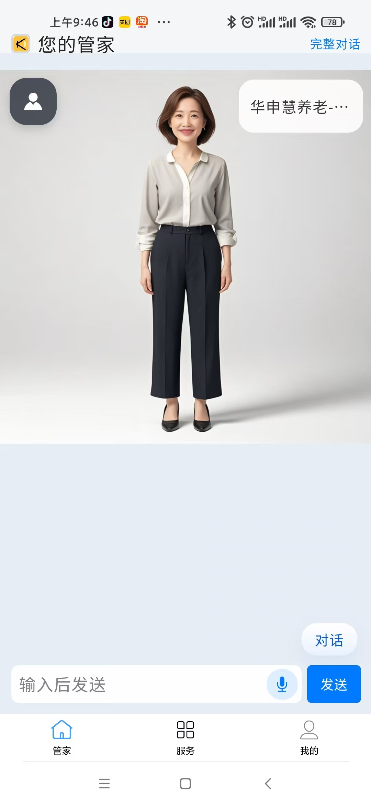
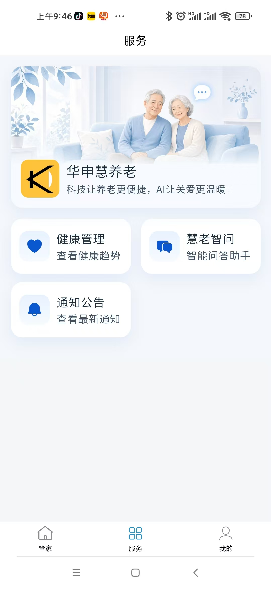
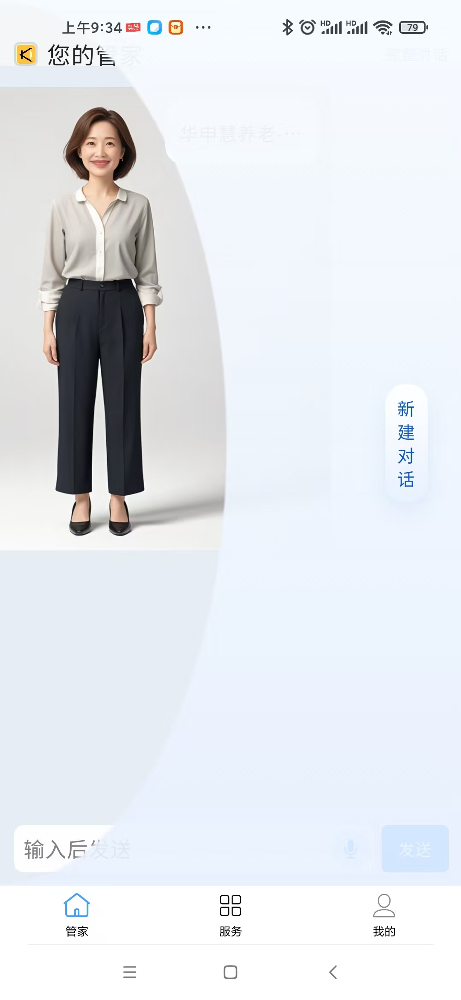
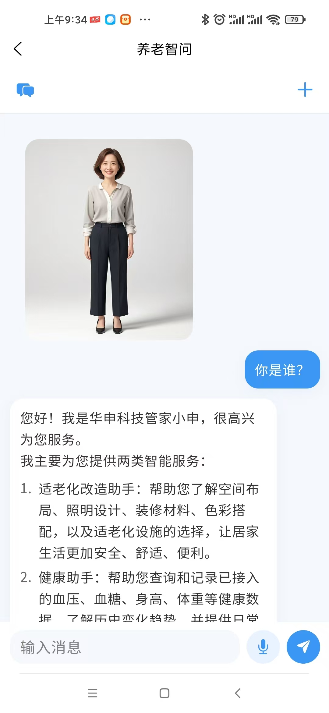
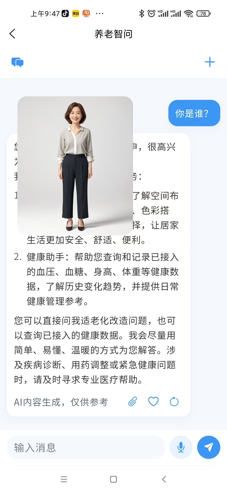
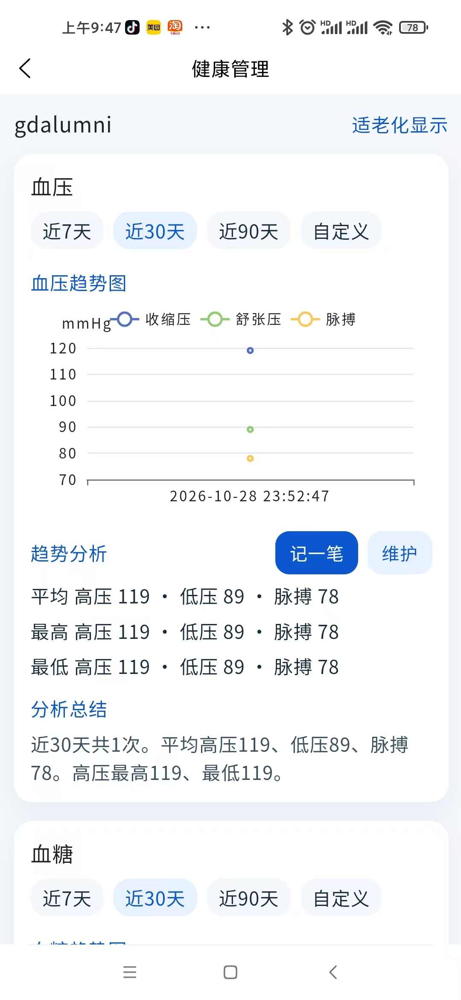

<h1 align="center" style="margin: 30px 0 30px; font-weight: bold;">RuoYi v1.2.0</h1>
<h4 align="center">华申慧养老-app端</h4>

## APP简介

华申慧养老移动端APP
 
## 演示图

<table>
    <tr>
        <td></td>
        <td></td>
		<td></td>
    </tr>
	<tr>
        <td></td>
        <td></td>
		<td></td>
    </tr>
</table>
