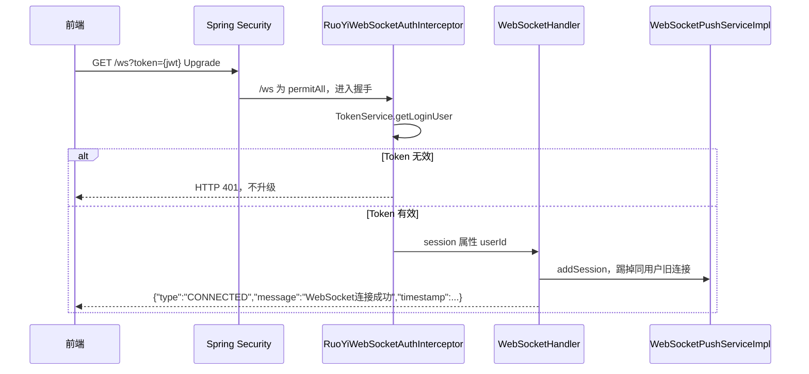
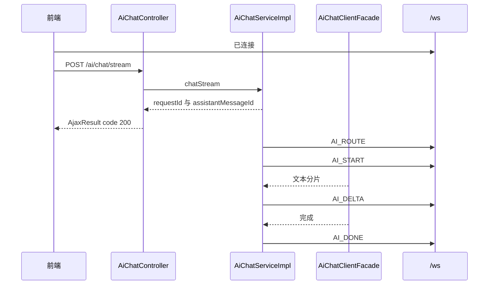
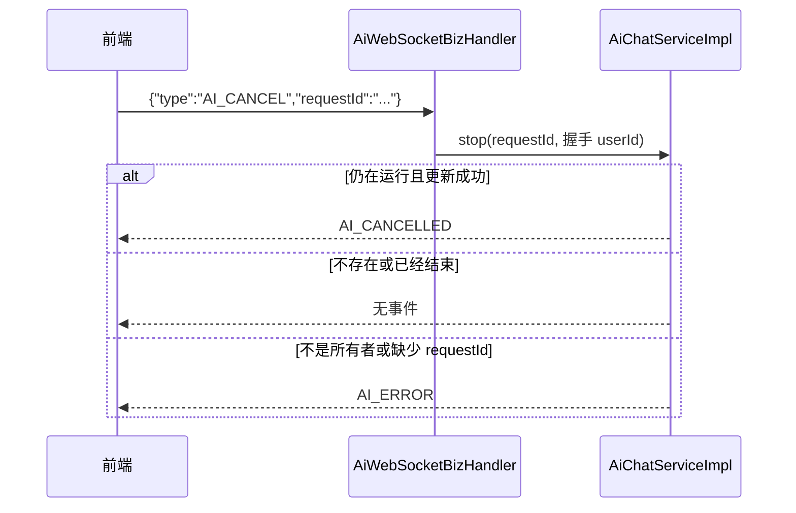
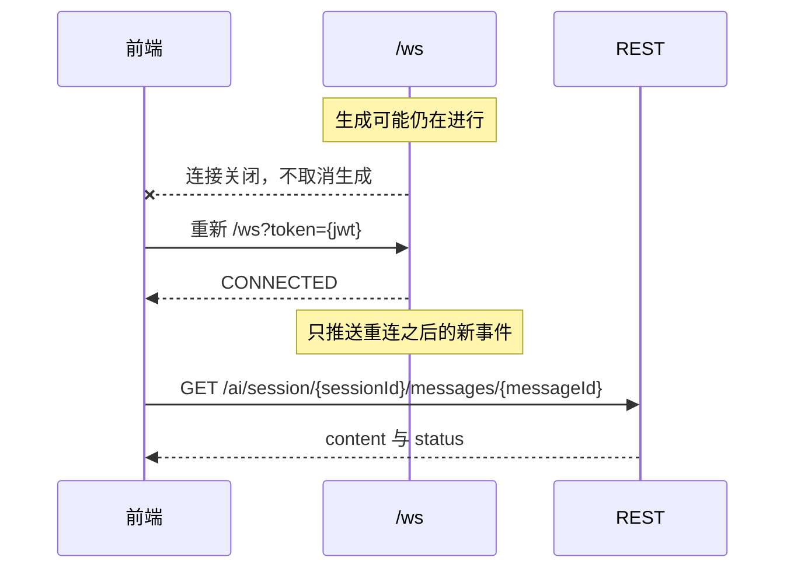

# ruoyi-ai WebSocket 通信协议

本文只描述当前仓库已经实现的行为。状态标记：

| 标记 | 含义 |
| --- | --- |
| 已实现 | 源码中有完整调用链 |
| 部分实现 | 有代码，但覆盖范围不完整 |
| 未实现 | 源码中不存在 |
| 待确认 | 行为依赖部署或前端工程，本仓库不能单独确定 |
| 建议设计 | 不是现有协议，仅供后续讨论 |

会话标识在代码里是 `sessionId`，没有 `conversationId`。一轮生成的标识是 `requestId`。助手消息标识是 `messageId`。没有 `taskId`，也没有 Agent 任务对象。

相关 HTTP 细节见 `docs/ruoyi-ai-api.md`。前端对接清单见 `docs/ruoyi-ai-frontend-integration.md`。

## 1. 协议概述

### 1.1 用途

`/ws` 是整个 RuoYi 后端共用的一条原生 WebSocket，不是 AI 专用端点。AI 模块通过它做两件事：

- 服务端把流式聊天事件推给当前登录用户。已实现。
- 客户端发送 `AI_CANCEL` 取消一轮正在运行的生成。已实现。

注册位置：`ruoyi-framework/.../websocket/WebSocketConfig.java` 的 `registerWebSocketHandlers`，路径字面量 `"/ws"`，未调用 `withSockJS()`。

### 1.2 与 REST 的分工

| 能力 | 实际入口 | 状态 |
| --- | --- | --- |
| 创建会话 | `POST /ai/session` | 已实现，REST |
| 提交用户文本并开始流式生成 | `POST /ai/chat/stream` | 已实现，REST。WebSocket 不能发起对话 |
| 同步拿到完整回复 | `POST /ai/chat` | 已实现，REST。此路径不推 WebSocket |
| 接收增量、开始、结束、失败、取消结果 | `/ws` 出站事件 | 已实现 |
| 取消一轮生成 | `POST /ai/chat/stop` 或 WebSocket `AI_CANCEL` | 已实现，两条路调用同一个 `IAiChatService.stop` |
| 历史与断线补齐 | `GET /ai/session/{sessionId}/messages` 等 | 已实现，REST。WebSocket 不补发 |

调用顺序：先 `POST /login` 拿 JWT，再连接 `/ws`，再 `POST /ai/chat/stream`。只连 WebSocket、不调 HTTP，不会开始模型生成。

### 1.3 与模型、Agent 的关系

流式文本来自 `AiChatClientFacade.stream`，底层是 Spring AI `ChatClient` 的 `stream().content()`，按字符串分片回调。已实现。客户端按数据库中的模型行懒创建并缓存在当前进程，`baseUrl` 必须去掉末尾斜杠后以 `/v1` 结尾，连接超时为 `ruoyi.ai.http-timeout-seconds`（当前 120 秒）。`application.yml` 里不再有 `spring.ai.openai.base-url` 或模型名回退。

意图 `CHAT` / `KNOWLEDGE` / `TASK` 会放进 HTTP 响应和 `AI_ROUTE`。`AiIntentResult` 把 `executionPath` 固定为 `CHAT`。知识库检索、工具调用、Agent 执行、任务确认都未实现。`AI_ROUTE` 不是 Agent 状态机。

### 1.4 明确不支持

- 通过 WebSocket 发送用户聊天内容。未实现。
- 指定 Agent、携带 `taskId`、任务确认或拒绝。未实现。
- 思考过程、工具调用开始/结束、Agent 状态事件。未实现。
- SockJS、STOMP、独立路径 `/ai/ws`。未实现。
- 服务端定时心跳、空闲断开、断点续传、事件序号。未实现。
- 按 AI 会话分房间。推送只按登录 `userId`。已实现的隔离粒度就是用户，不是会话。

`WebSocketHandler` 类注释仍写「主要定位为 Server -> Client，业务消息只做接收入口」。这与后面的 `handleBusinessMessage` 以及已注册的 `AiWebSocketBizHandler` 不一致。以实际分发代码为准：`AI_CANCEL` 会被处理。

## 2. 连接建立与连接地址

### 2.1 路径与地址

| 项 | 值 | 依据 |
| --- | --- | --- |
| 路径 | `/ws` | `WebSocketConfig.registerWebSocketHandlers` |
| context-path | `/` | `ruoyi-admin/src/main/resources/application.yml` 的 `server.servlet.context-path` |
| 开发端口 | `8080` | 同文件 `server.port` |
| 开发地址 | `ws://{host}:8080/ws` | 由上面三项拼出。仓库没有写死主机名 |
| TLS | 未配置 | `application.yml` 没有 `server.ssl`。当前源码对应 `ws://` |
| 生产 `wss://` | 待确认 | 只有部署在 HTTPS 终结之后才用 `wss`。本仓库没有该配置 |

没有环境变量覆盖 WebSocket 路径。最终地址 = 实际对外主机和协议 + `context-path` + `/ws`。若网关改了前缀，以前缀为准，仓库内看不到该前缀。

本仓库没有 `RuoYi-Vue3-master`。前端常见的 `/dev-api` 是开发代理前缀，不是后端路径。WebSocket 代理是否放行 `Upgrade` 待确认。

### 2.2 握手

实现类：`RuoYiWebSocketAuthInterceptor.beforeHandshake`。

| 方式 | 状态 | 说明 |
| --- | --- | --- |
| 请求头 `Authorization: Bearer {jwt}` | 已实现 | 头名来自 `token.header`，当前配置为 `Authorization`。优先于 Query |
| Query `token` | 已实现 | `/ws?token={jwt}`。浏览器 `WebSocket` 不能自定义头时用这个。值可以带或不带 `Bearer ` 前缀，拦截器会去掉前缀 |
| Cookie | 未实现 | 拦截器不读 Cookie |
| 连接后发 `AUTH` 消息登录 | 未实现，且被拒绝 | `WebSocketHandler` 收到 `AUTH` 只打警告日志，不改身份，不回复 |

Spring Security 对 `/ws` 是 `permitAll`（`SecurityConfig`）。过滤器不会拦握手。身份是否有效由拦截器决定。

失败时 `response.setStatusCode(HttpStatus.UNAUTHORIZED)` 并 `return false`，连接不会升级。这是握手 HTTP **401**，不是业务 JSON 里的 `code: 401`。触发条件：不是 Servlet 请求、没有 Token、去掉前缀后为空、`TokenService.getLoginUser` 返回 null、`userId` 为空。

Origin：`setAllowedOriginPatterns("*")`。已实现，允许任意 Origin。没有额外的 Origin 白名单配置。

跨域 HTTP 过滤器对 `/**` 允许任意 Origin、头和方法，未调用 `setAllowCredentials`。WebSocket 浏览器握手本身不走该 JSON CORS 预检的同一条业务逻辑，但 Origin 模式已放开。

### 2.3 连接成功后

`WebSocketHandler.afterConnectionEstablished`：

1. 从握手属性读取 `userId`。没有则 `close(CloseStatus.NOT_ACCEPTABLE)`，关闭码 1003。
2. `WebSocketPushServiceImpl.addSession(userId, session)`。
3. 立刻发送系统帧（字段是 `message`，不是 AI 事件的 `data`）：

```json
{
  "type": "CONNECTED",
  "message": "WebSocket连接成功",
  "timestamp": 1760590800000
}
```

同一 `userId` 只保留一条连接。新连接调用无参 `oldSession.close()`，Spring 按 `CloseStatus.NORMAL`（1000）关闭旧连接。没有单独的「被踢」业务帧。`removeSession(userId, session)` 按 session 对象删除，避免旧连接的关闭回调清掉新连接。

## 3. 身份认证与权限控制

### 3.1 连接认证

已实现。流程在 `RuoYiWebSocketAuthInterceptor`：

1. 取 Header，否则取 `token` 参数。
2. 去掉 `Bearer `（`Constants.TOKEN_PREFIX`）。
3. 包装成带 `Authorization` 的请求，调用 `TokenService.getLoginUser`。
4. 解析 JWT，用其中的登录 uuid 读 Redis 里的 `LoginUser`。
5. 把 `userId`、`loginUser`、`token` 放进 WebSocket session 属性。

用户 id 只来自这一步。入站 JSON 里的 `userId` 不会被读取。`AiWsProtocol` 注释写明身份来自握手 JWT。已实现。

`TokenService.verifyToken` 会在 HTTP 请求距过期不足 20 分钟时延长 Redis。WebSocket 握手**不**调用 `verifyToken`，因此握手本身不续期。连接建立后代码不再检查 Token。Token 随后过期不会主动断开这条连接。部分实现：只在握手时认证。

登出 `POST /logout` 删除 Redis 登录态，不会关闭已经建立的 WebSocket。已核对 `LogoutSuccessHandlerImpl`，其中没有 WebSocket 调用。

### 3.2 会话与任务权限

代码里没有 `conversationId`、`taskId`。对照关系：

| 检查项 | 实际做法 | 状态 |
| --- | --- | --- |
| 防止伪造 userId | 推送和取消都使用握手里的 `userId` | 已实现 |
| 会话所有权 | 不在 WebSocket 入站消息里检查 `sessionId`。流式开始时 HTTP `checkWritable` 要求当前用户是会话所有者 | 已实现于 REST，不在 WS 帧里重复校验 |
| `requestId` 是否属于当前用户 | `AiChatServiceImpl.stop` 比较操作者与 Redis 运行上下文或助手消息的 `userId`。不符则 `no permission to stop this task` | 已实现 |
| 菜单权限 `ai:chat:chat` | 只标在 HTTP 聊天接口的 `@PreAuthorize`。`AI_CANCEL` 不检查该权限 | 缺失。已登录即可对**自己的** `requestId` 发取消 |
| 读历史 | 不是 WebSocket。REST `ai:session:query`，外加所有者或 `userId==1` | 已实现于 REST |
| 任务确认 | 无此操作 | 未实现 |
| 会话不存在 | HTTP 返回 `session not found`。WebSocket 不负责查会话 | 已实现于 REST |
| 连接后 Token 过期 | 不处理 | 未实现 |

`userId == 1` 的管理员可读他人会话（REST），但不能替他人 `stop`。`stop` 使用 `operatorUserId.equals(ownerId)`，没有管理员豁免。

## 4. 消息协议总览

存在两套 JSON，不要混用。

### 4.1 系统帧

由 `WebSocketHandler.sendSystemMessage` / `sendError` 直接拼 JSON。没有 `requestId`，没有 `data`。

| type | 方向 | 触发 | 字段 |
| --- | --- | --- | --- |
| `CONNECTED` | 服务端 → 客户端 | 连接登记成功后立刻发送 | `type`、`message`=`WebSocket连接成功`、`timestamp` 毫秒 |
| `PONG` | 服务端 → 客户端 | 收到客户端 `PING` | `type`、`message`=`pong`、`timestamp` |
| `ERROR` | 服务端 → 客户端 | 文本不是 JSON、没有 `type`、业务处理器抛出未捕获异常 | `type`、`code` 字符串、`message`、`timestamp` |

`ERROR` 的 `code` 只有三个字面量：

| code | message | 触发 |
| --- | --- | --- |
| `INVALID_MESSAGE` | `消息格式错误` | `readTree` 抛异常 |
| `UNKNOWN_MESSAGE` | `未知消息类型` | JSON 里没有 `type` 字段 |
| `BIZ_ERROR` | `业务消息处理失败` | `WebSocketBizHandler.handle` 抛出未捕获异常 |

`AI_CANCEL` 内部自己捕获异常并改推 AI 帧 `AI_ERROR`，正常取消失败不会变成 `BIZ_ERROR`。

### 4.2 AI 帧

由 `AiWsEvent` 经 `WebSocketPushServiceImpl` 的独立 `ObjectMapper` 序列化。信封固定为：

| 字段 | 类型 | 必填 | 含义 |
| --- | --- | --- | --- |
| `type` | string | 是 | 事件名 |
| `requestId` | string 或 null | 视事件 | 这一轮生成的 id |
| `data` | object | 是 | 事件体。空事件也会是 `{}`，因为 `AiWsEvent.data` 默认是空 Map |
| `timestamp` | number | 是 | 构造事件时的 `System.currentTimeMillis()` |

这不是系统帧。系统帧没有 `data`。

### 4.3 客户端 → 服务端

`type` 先 `toUpperCase()` 再分发，大小写不敏感。

| type | 状态 | 行为 |
| --- | --- | --- |
| `PING` | 已实现 | 回系统帧 `PONG`。无请求体要求 |
| `PONG` | 已实现 | 忽略 |
| `AUTH` | 已实现为拒绝 | 忽略，不回复 |
| `AI_CANCEL` | 已实现 | 见第 7 节 |
| 没有 `type` | 已实现 | 系统帧 `UNKNOWN_MESSAGE` |
| 非法 JSON | 已实现 | 系统帧 `INVALID_MESSAGE` |
| 空文本 | 已实现 | 直接 return，不回复 |
| 其他 type | 已实现为无响应 | 打调试日志，不回复 |

没有「发送聊天内容」的 type。

#### PING

```json
{ "type": "PING" }
```

预期响应：

```json
{ "type": "PONG", "message": "pong", "timestamp": 1760590800000 }
```

#### AI_CANCEL

`requestId` 优先取信封，否则取 `data.requestId`。`AiWebSocketBizHandlerTest.resolveRequestIdPrefersEnvelope` 锁定了这个顺序。

```json
{
  "type": "AI_CANCEL",
  "requestId": "8a1b2c3d-4e5f-4678-9abc-def012345678"
}
```

等价写法：

```json
{
  "type": "AI_CANCEL",
  "data": { "requestId": "8a1b2c3d-4e5f-4678-9abc-def012345678" }
}
```

不要在 `data` 里传 `userId` 当作身份。服务端不使用该字段。

### 4.4 服务端 → 客户端的 AI 事件

只在流式路径推送：`POST /ai/chat/stream` 和 `POST /ai/chat/retry`。`POST /ai/chat` 同步聊天不推这些事件。用户不在线时 `sendToUser` 直接返回，不排队。

| type | 触发 | data 字段 | 状态 |
| --- | --- | --- | --- |
| `AI_ROUTE` | `doStream` 在读模型流之前，意图对象非空时 | `intent`、`confidence`、`reason`、`executionPath` | 已实现。当前每次新流式都会先路由，意图对象不会是 null |
| `AI_START` | 紧接 `AI_ROUTE` 之后 | `sessionId`、`messageId` | 已实现 |
| `AI_DELTA` | 模型每产生一段非空文本 | `sessionId`、`messageId`、`delta` | 已实现 |
| `AI_DONE` | 流正常结束且数据库仍是运行中、更新成功 | `sessionId`、`messageId`、`content` | 已实现 |
| `AI_CANCELLED` | 取消且数据库更新成功 | `sessionId`、`messageId`、`content` | 已实现 |
| `AI_ERROR` | 失败、超时、校正中断，或取消参数/权限错误 | `msg`，以及可能有的 `sessionId`、`messageId` | 已实现 |

`messageId` 一律是**助手消息** id，不是用户消息 id。关联一轮生成用 `requestId`。代码中没有 `taskId`。

## 5. 发起 AI 对话

WebSocket **不能**发起对话。已实现的顺序：

1. `POST /ai/session` 创建会话，得到 `sessionId`。权限 `ai:session:add`。
2. 连接 `/ws` 并收到 `CONNECTED`。
3. `POST /ai/chat/stream`，Body 为 `AiChatRequest`：`sessionId`、`content` 必填，`modelId` 可选，`requestId` 可选且最长 64。权限 `ai:chat:chat`。
4. HTTP 立即返回 `AiChatStartResult`，其中 `assistantMessageId` 就是后续事件的 `messageId`，`requestId` 就是事件信封上的 `requestId`。
5. 之后只在 WebSocket 上收 `AI_ROUTE`、`AI_START`、`AI_DELTA`、结束事件。

不支持在 WebSocket 上指定 Agent 或关联 `taskId`。未实现。

服务端「已接收」的确认是 HTTP 200 且 JSON `code` 为 200，不是 WebSocket ACK。若未连接，HTTP 仍可能成功，增量被丢弃。

重复提交同一个 `requestId`：若该助手消息已属于当前用户和当前会话，HTTP 返回已有 `assistantMessageId`，`userMessageId` 为 null，**不会**再次推流。这是 REST 幂等，不是 WebSocket 去重。

参数错误发生在 HTTP，例如 `content is required`，JSON `code` 为 500。WebSocket 上没有对应的校验失败帧。

重试 `POST /ai/chat/retry` 同样走流式事件。它不新增用户消息，`userMessageId` 为 null，`assistantMessageId` 是一条新的助手消息，`requestId` 由服务端新生成。

### HTTP 受理示例

请求 `POST /ai/chat/stream`：

```json
{
  "sessionId": 1,
  "content": "你好"
}
```

响应：

```json
{
  "code": 200,
  "msg": "操作成功",
  "data": {
    "sessionId": 1,
    "requestId": "8a1b2c3d-4e5f-4678-9abc-def012345678",
    "userMessageId": 21,
    "assistantMessageId": 22,
    "intent": "CHAT",
    "intentConfidence": 1.0,
    "intentReason": "default CHAT",
    "executionPath": "CHAT"
  }
}
```

随后 WebSocket 才出现第 6 节的事件。`executionPath` 当前恒为 `CHAT`。

## 6. 流式输出协议

实现位置：`AiChatServiceImpl.doStream`、`finishDone`、`finishFailed`、`finishCancelled`。分片来自 `AiChatClientFacade.stream`，空字符串会被滤掉。

| 期望能力 | 真实事件 | 状态 |
| --- | --- | --- |
| 消息开始 | `AI_START` | 已实现 |
| 内容增量 | `AI_DELTA` 的 `data.delta` | 已实现。是增量，不是累计全文 |
| 思考过程 | 无 | 未实现 |
| 工具调用 | 无 | 未实现 |
| Agent 状态 | 无。`AI_ROUTE` 只是意图元数据 | 未实现 |
| 正常结束 | `AI_DONE` | 已实现 |
| 失败 | `AI_ERROR` | 已实现 |
| 取消 | `AI_CANCELLED` | 已实现 |

关联方式：用 HTTP 返回的 `requestId` 和 `assistantMessageId` 匹配事件的 `requestId` 和 `data.messageId`。`data.sessionId` 是会话 id。没有 `taskId`。

拼接：按到达顺序把 `delta` 追加到该 `messageId` 的缓冲区。`AI_DONE` 和 `AI_CANCELLED` 的 `data.content` 是服务端累计全文，应覆盖本地拼接结果。`AI_ERROR` 的 `data` **没有** `content`。失败时已生成的半截文字在数据库里，要用 `GET /ai/session/{sessionId}/messages/{messageId}` 读取。

完成判定：

- 收到 `AI_DONE`：正常结束，消息状态变为 `1`。
- 收到 `AI_CANCELLED`：用户取消成功，状态变为 `2`。不会再发 `AI_DONE`。
- 收到带 `sessionId` 和 `messageId` 的 `AI_ERROR`：这一轮失败，状态变为 `3`。不会再发 `AI_DONE`。
- 数据库条件更新影响 0 行时，完成、取消、失败都不再推送对应终态事件。并发下可能只看到增量、看不到终态，需要再查消息详情。

约每 `ruoyi.ai.stream-persist-interval-ms`（配置为 500）把累计文本写回数据库，状态仍为 `0`。这不是单独的 WebSocket 类型。

### 6.1 AI_ROUTE

```json
{
  "type": "AI_ROUTE",
  "requestId": "8a1b2c3d-4e5f-4678-9abc-def012345678",
  "data": {
    "intent": "CHAT",
    "confidence": 1.0,
    "reason": "default CHAT",
    "executionPath": "CHAT"
  },
  "timestamp": 1760590800000
}
```

| 字段 | 类型 | 含义 |
| --- | --- | --- |
| `intent` | string | `CHAT`、`KNOWLEDGE` 或 `TASK` |
| `confidence` | number | 规则命中时 `TASK` 为 0.8，`KNOWLEDGE` 为 0.75，默认聊天为 1.0 |
| `reason` | string | 规则说明 |
| `executionPath` | string | 当前恒为 `CHAT` |

前端应继续按聊天展示，不要因为 `TASK` 进入任务界面。

### 6.2 AI_START

```json
{
  "type": "AI_START",
  "requestId": "8a1b2c3d-4e5f-4678-9abc-def012345678",
  "data": { "sessionId": 1, "messageId": 22 },
  "timestamp": 1760590800100
}
```

### 6.3 AI_DELTA

```json
{
  "type": "AI_DELTA",
  "requestId": "8a1b2c3d-4e5f-4678-9abc-def012345678",
  "data": { "sessionId": 1, "messageId": 22, "delta": "你好" },
  "timestamp": 1760590800200
}
```

### 6.4 AI_DONE

```json
{
  "type": "AI_DONE",
  "requestId": "8a1b2c3d-4e5f-4678-9abc-def012345678",
  "data": {
    "sessionId": 1,
    "messageId": 22,
    "content": "你好，有什么可以帮你？"
  },
  "timestamp": 1760590803000
}
```

不含 token 用量。流式路径不回写 token。

### 6.5 AI_ERROR

```json
{
  "type": "AI_ERROR",
  "requestId": "8a1b2c3d-4e5f-4678-9abc-def012345678",
  "data": {
    "sessionId": 1,
    "messageId": 22,
    "msg": "AI model stream failed: connection reset"
  },
  "timestamp": 1760590802600
}
```

取消参数错误时可能没有 `sessionId` 和 `messageId`：

```json
{
  "type": "AI_ERROR",
  "requestId": null,
  "data": { "msg": "requestId is required" },
  "timestamp": 1760590802600
}
```

### 6.6 一次成功对话的事件顺序

`AI_ROUTE` → `AI_START` → 零个或多个 `AI_DELTA` → `AI_DONE`。

```json
{"type":"AI_ROUTE","requestId":"8a1b2c3d-4e5f-4678-9abc-def012345678","data":{"intent":"CHAT","confidence":1.0,"reason":"default CHAT","executionPath":"CHAT"},"timestamp":1760590800000}
{"type":"AI_START","requestId":"8a1b2c3d-4e5f-4678-9abc-def012345678","data":{"sessionId":1,"messageId":22},"timestamp":1760590800100}
{"type":"AI_DELTA","requestId":"8a1b2c3d-4e5f-4678-9abc-def012345678","data":{"sessionId":1,"messageId":22,"delta":"你好"},"timestamp":1760590800200}
{"type":"AI_DONE","requestId":"8a1b2c3d-4e5f-4678-9abc-def012345678","data":{"sessionId":1,"messageId":22,"content":"你好"},"timestamp":1760590800300}
```

上面四条是同一条连接上先后收到的文本帧，不是一个 JSON 数组。

## 7. 取消生成与任务控制

取消的是一轮生成（一个 `requestId` / 一条运行中的助手消息），不是「整个会话」，也不是不存在的 Agent 任务。

两条已实现入口，都进入 `AiChatServiceImpl.stop(requestId, operatorUserId)`：

| 方式 | 请求 | 受理信号 |
| --- | --- | --- |
| REST | `POST /ai/chat/stop`，JSON `{"requestId":"..."}`，权限 `ai:chat:chat` | HTTP `code` 200、`msg` 操作成功。成功体没有 `data` |
| WebSocket | `AI_CANCEL` | 没有单独的 ACK。真正停掉时推 `AI_CANCELLED` |

`stop` 的行为：

1. `requestId` 为空：抛 `requestId is required`。HTTP 变成 JSON `code` 500。WebSocket 推 `AI_ERROR`，且不带消息 id。
2. Redis 和数据库都找不到：直接 return。HTTP 仍是成功。WebSocket **不**推事件。
3. 不是所有者：抛 `no permission to stop this task`。HTTP 为 500。WebSocket 推 `AI_ERROR`，`data.msg` 为该句，`requestId` 为提交的值，没有 `sessionId`/`messageId`。
4. 助手消息已经不是运行中（`status != 0`）：直接 return。不推 `AI_CANCELLED`。
5. 仍在运行：置取消标记、dispose 模型订阅，把已生成文本写成状态 `2`。更新成功才推 `AI_CANCELLED`。更新 0 行则不推。

`AI_CANCELLED` 示例：

```json
{
  "type": "AI_CANCELLED",
  "requestId": "8a1b2c3d-4e5f-4678-9abc-def012345678",
  "data": {
    "sessionId": 1,
    "messageId": 22,
    "content": "已经生成的部分"
  },
  "timestamp": 1760590802500
}
```

`content` 可能是空字符串。已完成（状态 `1`）、已停止（`2`）、已失败（`3`）的消息不会再次取消，也没有失败帧。

只关闭 WebSocket 或前端停止渲染 **不会** 停止模型。`afterConnectionClosed` 只移除 session。生成继续，后续事件若用户已重连则发给新连接，否则丢弃。

未预期异常时 WebSocket 推 `AI_ERROR`，`data.msg` 为 `cancel failed`。

超时不是用户取消。`AiTimeoutTask.markTimeout` 每 60 秒调用 `abortTimedOutRuns`。创建时间早于 `ruoyi.ai.run-timeout-seconds`（300 秒）的运行中助手消息会被标为失败，并推 `AI_ERROR`，`msg` 为 `generation timeout`。这是服务端定时任务，不是客户端消息。

## 8. 心跳与连接保活

| 项 | 状态 | 事实 |
| --- | --- | --- |
| 应用层心跳请求 | 已实现 | 客户端可发 `{"type":"PING"}` |
| 应用层心跳响应 | 已实现 | 服务端回 `PONG` 系统帧 |
| 客户端发 `PONG` | 已实现 | 服务端忽略 |
| 服务端主动心跳 | 未实现 | 没有定时任务向客户端发 `PING` |
| 心跳间隔 | 未定义 | 源码和 yml 都没有心跳间隔。前端可以发，后端不要求周期 |
| WebSocket 协议层 Ping/Pong | 未实现 | `WebSocketHandler` 没有重写协议层 ping 处理，也没有容器 idle 配置 |
| 无活动断开 | 未实现 | 没有空闲超时配置 |
| 前端如何判断失效 | 待前端实现 | 只能看 `onclose` / `onerror`，或自己发 `PING` 后长时间没有 `PONG`。后端没有规定超时秒数 |

不要把某一秒数写成协议要求。

## 9. 断线与重连

### 9.1 已实现的断开原因

| 原因 | 表现 |
| --- | --- |
| 握手失败 | HTTP 401，不会进入 `onopen` |
| 建连后没有 userId | 关闭码 1003 `NOT_ACCEPTABLE` |
| 传输异常 | 先移除会话，再关闭码 1011 `SERVER_ERROR` |
| 同一用户新连接 | 旧连接被无参 `close()`，关闭码 1000 `NORMAL`，没有业务帧 |
| 客户端主动 `close()` | `afterConnectionClosed` 移除该 session |

### 9.2 未实现的恢复能力

- 服务端自动重连。未实现。
- 重连后补发断线期间的 `AI_DELTA`。未实现。
- 消息序号、事件 id、断点 offset。未实现。
- 关闭连接时取消生成。未实现。

重连必须重新握手，再次提供有效 JWT。握手失败则连不上。

重连后的恢复只能走 REST，这是已实现的替代，不是续传：

1. `GET /ai/session/{sessionId}/messages/{messageId}` 读取当前 `content` 和 `status`。
2. 若仍显示运行中，可 `POST /ai/session/{sessionId}/reconcile`。运行键丢失或已超过超时时间时，消息会被标失败并可能再推一条 `AI_ERROR`（`generation interrupted`）。
3. 若新连接发生在生成结束前，**之后**的新事件会推到新连接。断线前已经发出的增量不会重放。因此前端不能保证拼出断线期间的每一个 `delta`，应以消息详情里的 `content` 为准。

避免重复发送用户消息：重试不要再次调用 `POST /ai/chat/stream` 提交同一段新内容，除非确实要新的一轮。同一 `requestId` 的 HTTP 幂等不会重新开流。页面上的「重试」应调用 `POST /ai/chat/retry`，并使用返回的新 `assistantMessageId`。

页面切换会话：连接是按用户而不是按会话建立的，不需要为每个会话新开 WebSocket。用 `requestId` / `messageId` 过滤事件即可。

退出登录：前端应主动 `close()`。服务端不会因为登出关掉连接。

多标签：后连接的标签踢掉先连接的标签。只有最后一条连接能收到推送。已实现。

## 10. 错误码及异常处理

WebSocket 没有数字业务码体系。系统帧的 `code` 是字符串。AI 失败把说明放在 `data.msg`。HTTP 错误仍是 JSON `code` 数字，且 HTTP 状态一般为 200。下表只列源码里真实出现的标识。

| 错误标识 | 触发条件 | 服务端返回格式 | 前端处理建议 | 实现状态 |
| --- | --- | --- | --- | --- |
| 握手 HTTP 401 | 无 Token、Token 无效、Redis 无登录态、userId 为空 | 握手失败，无统一 JSON | 重新登录后再连 | 已实现 |
| `INVALID_MESSAGE` | 文本不是 JSON | 系统帧 `ERROR` | 检查发送的是否为 JSON | 已实现 |
| `UNKNOWN_MESSAGE` | JSON 没有 `type` | 系统帧 `ERROR` | 补上 `type` | 已实现 |
| `BIZ_ERROR` | 业务处理器抛出未捕获异常 | 系统帧 `ERROR` | `AI_CANCEL` 正常路径不会走这里 | 已实现 |
| `requestId is required` | 取消时没有 id | AI 帧 `AI_ERROR`，`data.msg` 为该句，通常无消息 id | 带上 `requestId` | 已实现 |
| `no permission to stop this task` | 取消他人的 `requestId` | 同上，`requestId` 为提交值 | 只取消自己发起的生成 | 已实现 |
| `cancel failed` | 取消过程未预期异常 | AI 帧 `AI_ERROR` | 再查消息状态 | 已实现 |
| `generation timeout` | 运行超过 300 秒后被定时任务终止 | AI 帧 `AI_ERROR`，带 `sessionId`、`messageId` | 把气泡标为失败 | 已实现 |
| `generation interrupted` | 打开历史或 reconcile 时运行键丢失或已超时 | 同上 | 用消息详情对齐半截正文 | 已实现 |
| `AI model stream failed: ...` | 模型流异常，明细截断 | AI 帧 `AI_ERROR` | 提供重试按钮，重试走 REST | 已实现 |
| `model baseUrl is not configured` | 模型行没有地址。发生在异步生成里，HTTP 开流可能已经成功 | AI 帧 `AI_ERROR` | 提示管理员补 `baseUrl`，不要重试同一配置 | 已实现 |
| `model baseUrl must end with /v1 (OpenAI-compatible path)` | 库存地址不以 `/v1` 结尾 | AI 帧 `AI_ERROR` | 同上。保存接口在传入地址时就会拦截，这条多见于旧数据 | 已实现 |
| `model API Key is not configured` / `model name is not configured` | 解密后密钥为空，或模型名为空 | AI 帧 `AI_ERROR` | 去模型管理页修正 | 已实现 |
| `failed to init chat model (modelId=...): ...` | 创建客户端失败，明细约 200 字符 | AI 帧 `AI_ERROR` | 检查地址是否可达、密钥是否有效 | 已实现 |
| 未知或已结束的 `requestId` | `stop` 直接 return | **没有**错误帧；HTTP stop 仍是成功 | 不要把「没有 AI_CANCELLED」当成失败，改查消息 `status` | 已实现，易误解 |
| 菜单权限不足 | 仅 HTTP `@PreAuthorize` | HTTP JSON `code` 403，`msg` 为 `没有权限，请联系管理员授权` | WebSocket 取消不检查该权限 | HTTP 已实现，WS 未检查 |
| HTTP 未登录 | 调 `/ai/chat/stream` 时无 JWT | HTTP JSON `code` 401 | 与握手 401 不是同一种载体 | 已实现 |
| `session not found` 等业务文案 | HTTP 校验 | HTTP JSON `code` 500，`msg` 为英文原文 | 发生在开流之前，没有 WS 事件 | 已实现 |
| 会话无权、任务不存在、Agent 失败的专用错误码 | 无对应枚举 | 无 | 不要编造错误码。会话问题看 HTTP `msg`；没有任务实体 | 未定义 |
| 连接关闭码 1003 | 建连后缺 userId | WebSocket close | 重新握手 | 已实现 |
| 连接关闭码 1011 | 传输异常 | WebSocket close | 重连后用 REST 对齐 | 已实现 |

全局异常处理器 `GlobalExceptionHandler` 只处理 HTTP，不包装 WebSocket 帧。

## 11. 完整交互时序

### 11.1 建立连接与认证



### 11.2 普通流式对话



同步 `POST /ai/chat` 没有图中的 WebSocket 消息。

### 11.3 用户取消



`POST /ai/chat/stop` 走同一个 `stop`。HTTP 成功体之外，是否有 `AI_CANCELLED` 规则相同。

### 11.4 断开与重连



服务端没有自动重连。上图的重连动作是前端自己做的。

### 11.5 Agent 任务

未实现。没有任务创建、确认、拒绝、状态事件。`intent=TASK` 时实际顺序仍是 11.2，且 `executionPath` 为 `CHAT`。

建议设计（不是现有协议）：不要新增一套未实现的 `AGENT_*` 事件名，除非后端以后提供源码。

## 12. 前端接入示例

本仓库没有 Vue3 源码，下面不是从 `RuoYi-Vue3-master` 复制的封装。字段名与当前后端一致。Token 和主机由调用方注入。

```javascript
export function connectAiSocket(token, onEvent) {
  const ws = new WebSocket(
    `ws://localhost:8080/ws?token=${encodeURIComponent(token)}`
  )

  ws.onmessage = (event) => {
    const msg = JSON.parse(event.data)
    onEvent(msg)
  }

  return {
    ws,
    cancel(requestId) {
      ws.send(JSON.stringify({ type: 'AI_CANCEL', requestId }))
    },
    close() {
      ws.close()
    }
  }
}

export function handleAiFrame(msg, bubbles) {
  if (msg.type === 'CONNECTED' || msg.type === 'PONG') {
    return
  }
  if (msg.type === 'ERROR') {
    console.error(msg.code, msg.message)
    return
  }
  if (msg.type === 'AI_ROUTE') {
    return
  }
  const id = msg.data && msg.data.messageId
  const bubble = bubbles.get(id)
  if (!bubble) {
    return
  }
  if (msg.type === 'AI_START') {
    bubble.status = '0'
  } else if (msg.type === 'AI_DELTA') {
    bubble.content += msg.data.delta || ''
  } else if (msg.type === 'AI_DONE' || msg.type === 'AI_CANCELLED') {
    bubble.content = msg.data.content || ''
    bubble.status = msg.type === 'AI_DONE' ? '1' : '2'
  } else if (msg.type === 'AI_ERROR') {
    bubble.status = '3'
    bubble.errorMsg = msg.data.msg
  }
}
```

开始对话仍要调用 `POST /ai/chat/stream`，用返回的 `assistantMessageId` 建立气泡，再等上面的帧。`PING` 可以发，但没有规定间隔：

```javascript
ws.send(JSON.stringify({ type: 'PING' }))
```

生产若页面是 HTTPS，地址改为部署环境给出的 `wss://` 主机，不要写死 `localhost:8080`。

## 13. 与 REST API 的协作关系

| 能力 | 实现 | 位置 |
| --- | --- | --- |
| 创建会话 | `POST /ai/session` | `AiSessionController.add` |
| 会话列表 | `GET /ai/session/list` | `AiSessionController.list` |
| 历史消息 | `GET /ai/session/{sessionId}/messages` | `AiSessionController.messages`。查询前可能校正中断任务并推 `AI_ERROR` |
| 发送并同步等待全文 | `POST /ai/chat` | `AiChatController.chat`。无 WebSocket |
| 发送并流式接收 | REST `POST /ai/chat/stream`，然后 WS `AI_ROUTE`/`AI_START`/`AI_DELTA`/`AI_DONE` | `AiChatController.stream`，`AiChatServiceImpl.doStream` |
| 获取任务状态 | 未实现。没有任务查询接口。生成状态看消息 `status`：`0` 运行中，`1` 完成，`2` 停止，`3` 失败 | `AiMessage.status`，`AiConstants` |
| 确认或拒绝 Agent 任务 | 未实现 | 无 Controller、无事件 |
| 取消 | REST `POST /ai/chat/stop` 或 WS `AI_CANCEL` | `AiChatController.stop`，`AiWebSocketBizHandler.handle` |
| 删除会话 | `DELETE /ai/session/{sessionIds}` | `AiSessionController.remove`。不关闭 WebSocket，不取消其他会话的生成 |
| 关闭会话 | `PUT /ai/session/close/{sessionId}` | `AiSessionController.close`。关闭后不能再开流 |

## 14. 实现差距与待办

### 14.1 已实现

- `/ws` 握手 JWT，Header 或 `token` 参数。
- 连接成功帧 `CONNECTED`。
- 用户级单连接，新连接踢旧连接。
- 流式事件 `AI_ROUTE`、`AI_START`、`AI_DELTA`、`AI_DONE`、`AI_ERROR`、`AI_CANCELLED`。
- `AI_CANCEL` 与 `POST /ai/chat/stop`。
- 客户端 `PING` / 服务端 `PONG`。
- 非法 JSON、缺 `type` 的系统错误帧。
- 超时与 reconcile 时推 `AI_ERROR`。

### 14.2 部分实现

- 认证只在握手时做，连接存续期间不校验 Token，登出不关连接。`RuoYiWebSocketAuthInterceptor`、`LogoutSuccessHandlerImpl`。
- `AI_CANCEL` 校验 `requestId` 所有者，不校验菜单权限 `ai:chat:chat`。`AiWebSocketBizHandler`。
- 取消未知或已结束任务时成功且无事件，前端无法单靠 WebSocket 判断。`AiChatServiceImpl.stop`。
- `AI_ERROR` 不带已生成正文。`AiWsProtocol.error`。
- `WebSocketHandler` 类注释与 `AI_CANCEL` 的实际处理不一致。以 `handleBusinessMessage` 为准。
- 意图 `TASK` / `KNOWLEDGE` 有事件字段，执行仍是聊天。`RuleBasedAiIntentRouter`、`AiChatServiceImpl.doStream`。

### 14.3 未实现

- WebSocket 发送聊天文本、创建会话、指定 Agent、`taskId`。
- 工具调用、思考过程、Agent 状态、任务确认/拒绝。
- 服务端心跳间隔、空闲断开、协议层 Ping 处理。
- 自动重连、增量回放、事件序号。
- 断线即取消生成。
- 按 `sessionId` 隔离推送。
- 多标签同时接收。

### 14.4 前端联调前必须确认

1. Vue 开发服务器是否把 `/ws` 的 Upgrade 代理到 `localhost:8080`。本仓库没有该前端配置。
2. 生产主机是 `ws` 还是 `wss`。`application.yml` 只有端口 8080 和 context-path `/`。
3. 产品是否接受「一个用户只有一条连接」。`WebSocketPushServiceImpl.addSession`。
4. 取消后如果没有 `AI_CANCELLED`，是否改为查消息详情，而不是提示失败。

### 14.5 若要补后端，需要新源码而不是改文档

- 连接后 Token 失效主动关闭。
- `AI_CANCEL` 与 HTTP 使用同一菜单权限。
- 断线期间事件缓存，或至少在重连后推送当前累计 `content`。
- 若要做 Agent，需要新的事件和 REST，不能复用现在的 `AI_ROUTE` 当作任务协议。

### 14.6 建议联调用例

1. 无 token 连接，期望握手 401。
2. 有效 token 连接，期望 `CONNECTED`。
3. 同账号开第二条连接，期望第一条被关闭，之后事件只到第二条。
4. `POST /ai/chat/stream` 后依次收到 `AI_ROUTE`、`AI_START`、若干 `AI_DELTA`、`AI_DONE`，且 `messageId` 等于 HTTP 的 `assistantMessageId`。
5. 生成中发 `AI_CANCEL`，期望 `AI_CANCELLED`，消息状态为 `2`，且没有随后的 `AI_DONE`。
6. 对已完成的 `requestId` 再取消，期望没有 `AI_CANCELLED`，HTTP stop 仍为成功。
7. 用别人的 `requestId` 取消，期望 `AI_ERROR` 且 `msg` 为 `no permission to stop this task`。
8. 生成中关掉连接再连上，期望旧 `delta` 不重放；消息详情里的 `content` 可能比断线前看到的更长。
9. 发送 `{"type":"PING"}`，期望 `PONG`。发送 `{"foo":1}`，期望 `UNKNOWN_MESSAGE`。
10. `POST /ai/chat` 同步成功时，WebSocket 上没有 `AI_DELTA`。
